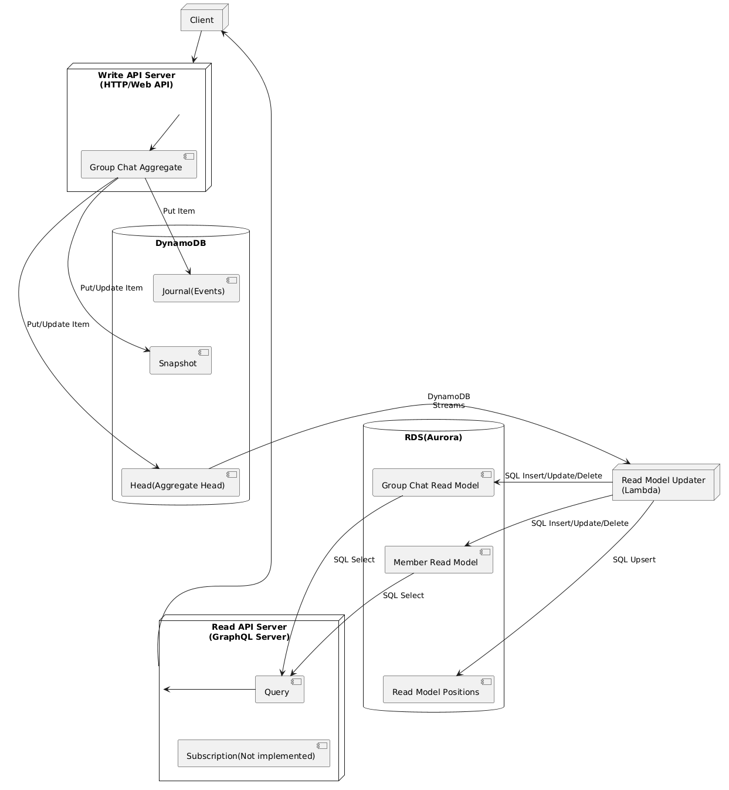

# cqrs-es-example-go

## 概要

これはGoで実装されたCQRS/Event Sourcing + GraphQLの例です。

このプロジェクトは、イベントソーシングのために[j5ik2o/event-store-adapter-go](j5ik2o/event-store-adapter-go)を使用しています。

[English](./README.md)

## フィーチャー

- [x] Write API Server(GraphQL)の実装
- [x] Read API Server(GraphQL)の実装
- [x] Local版のRead Model Updaterの実装
- [x] Docker Composeによる動作確認
- [ ] AWS Lambda版のRead Model Updaterの実装
- [ ] AWSへのデプロイ

## コンポーネント構成

- Write API Server
  - GraphQLによって実装された書き込み専用API
  - イベントに基づく集約は[j5ik2o/event-store-adapter-go](https://github.com/j5ik2o/event-store-adapter-go)によって実装されている。
- Read Model Updater
  - headテーブルのDynamoDB Streamsに基づいて読み取りモデルを構築するLambda
  - ローカルで、Lambdaの動作をエミュレートするコードを実行する（local-rmu）
- Read API Server
  - GraphQLによって実装された読み取り専用API

## 設定

各アプリケーションは環境変数から設定を読み取る。

| アプリケーション | 環境変数 |
|:--|:--|
| Write API | `PERSISTENCE_JOURNAL_TABLE_NAME`、`PERSISTENCE_SNAPSHOT_TABLE_NAME`、`PERSISTENCE_HEAD_TABLE_NAME`、`PERSISTENCE_SNAPSHOT_HISTORY_INDEX_NAME`、`AWS_REGION`、`AWS_DYNAMODB_ENDPOINT_URL`、`AWS_DYNAMODB_ACCESS_KEY_ID`、`AWS_DYNAMODB_SECRET_ACCESS_KEY`、`API_HOST`、`API_PORT` |
| Read Model Updater | `STREAM_HEAD_TABLE_NAME`、`STREAM_JOURNAL_TABLE_NAME`、`STREAM_MAX_ITEM_COUNT`、`DATABASE_URL`、`AWS_REGION`、`AWS_DYNAMODB_ENDPOINT_URL`、`AWS_DYNAMODB_ACCESS_KEY_ID`、`AWS_DYNAMODB_SECRET_ACCESS_KEY` |
| Read Model Updater（Lambda） | `DATABASE_URL`、`PERSISTENCE_JOURNAL_TABLE_NAME`、`PERSISTENCE_HEAD_TABLE_NAME`、`PERSISTENCE_MAX_EVENTS_PER_TRANSACTION`、`RMU_RETRY_MAX_ATTEMPTS`、`RMU_RETRY_MAX_ELAPSED`、`RMU_RETRY_INITIAL_DELAY`、`RMU_RETRY_MAX_DELAY`、`AWS_REGION` |
| RMU 復旧ワーカー | `DATABASE_URL`、`PERSISTENCE_JOURNAL_TABLE_NAME`、`PERSISTENCE_HEAD_TABLE_NAME`、`PERSISTENCE_MAX_EVENTS_PER_TRANSACTION`、`AWS_REGION` |
| Read API | `DATABASE_URL`、`API_HOST`、`API_PORT` |

ローカルのRead Model UpdaterはheadテーブルのStreamsを購読する。集約のseq_nrに欠番を見つけると、不足しているイベントをジャーナルから読む。処理済みの位置は、リードモデルの更新と同じトランザクションで`read_model_positions`に記録する。

再試行、復旧タスク（DLQ）、再同期の動きは[Read Model Updaterの復旧](docs/RMU_RECOVERY.ja.md)にまとめている。Lambda のイベントソースマッピングと SQS 復旧ワーカーのデプロイ資産は [deploy/rmu](deploy/rmu/README.md) にある。

## スタック

このOSSリポジトリは、主に以下の技術スタックを利用している。

- [99designs/gqlgen](https://github.com/99designs/gqlgen)
- [jmoiron/sqlx](https://github.com/jmoiron/sqlx)
- [j5ik2o/event-store-adapter-go](https://github.com/j5ik2o/event-store-adapter-go)

## システムアーキテクチャ図

## 開発環境

- [ツールのセットアップ](docs/TOOLS_INSTALLATION.ja.md)

### ローカル環境

- [Docker Composeでのデバッグ](docs/DEBUG_ON_DOCKER_COMPOSE.ja.md)

## 参考リンク

- [Rust版](https://github.com/j5ik2o/cqrs-es-example-rs)
- [TypeScript版](https://github.com/j5ik2o/cqrs-es-example-js)
- [共通ドキュメント](https://github.com/j5ik2o/cqrs-es-example-docs)
