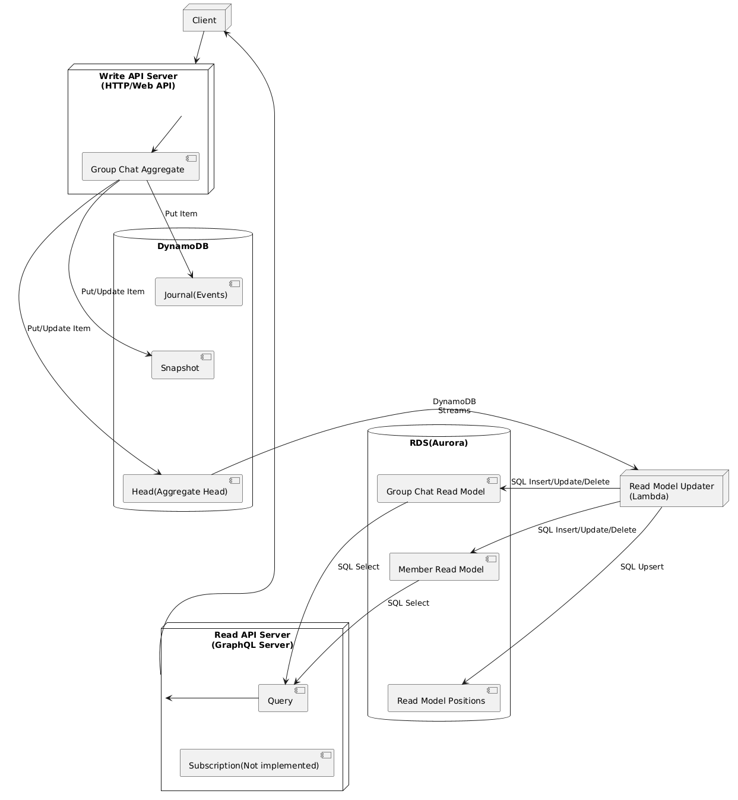

# cqrs-es-example-go

## Overview

This is an example of CQRS/Event Sourcing and GraphQL implemented in Go. This example is class-based, not actor-model based.

This project uses [j5ik2o/event-store-adapter-go](https://github.com/j5ik2o/event-store-adapter-go) for Event Sourcing.

Please refer to [here](https://github.com/j5ik2o/cqrs-es-example) for implementation examples in other languages.

[日本語](./README.ja.md)

## Feature

- [x] Write API Server(GraphQL)
- [x] Read API Server(GraphQL)
- [x] Read Model Updater on Local
- [x] Docker Compose Support
- [ ] Read Model Updater on AWS Lambda
- [ ] Deployment to AWS

## Component Composition

- Write API Server
  - API is implemented by GraphQL (Mutation)
  - Event Sourced Aggregate is implemented by [j5ik2o/event-store-adapter-go](https://github.com/j5ik2o/event-store-adapter-go)
- Read Model Updater
  - Builds read models from the head table's DynamoDB Streams
  - Locally, run code that emulates Lambda behavior (local-rmu)
- Read API Server
  - API is implemented by GraphQL (Query)

## Configuration

The applications read their settings from environment variables.

| Application | Variables |
|:--|:--|
| Write API | `PERSISTENCE_JOURNAL_TABLE_NAME`, `PERSISTENCE_SNAPSHOT_TABLE_NAME`, `PERSISTENCE_HEAD_TABLE_NAME`, `PERSISTENCE_SNAPSHOT_HISTORY_INDEX_NAME`, `AWS_REGION`, `AWS_DYNAMODB_ENDPOINT_URL`, `AWS_DYNAMODB_ACCESS_KEY_ID`, `AWS_DYNAMODB_SECRET_ACCESS_KEY`, `API_HOST`, `API_PORT` |
| Read Model Updater | `STREAM_HEAD_TABLE_NAME`, `STREAM_JOURNAL_TABLE_NAME`, `STREAM_MAX_ITEM_COUNT`, `RECOVERY_MAX_TASKS_PER_PASS`, `DATABASE_URL`, `AWS_REGION`, `AWS_DYNAMODB_ENDPOINT_URL`, `AWS_DYNAMODB_ACCESS_KEY_ID`, `AWS_DYNAMODB_SECRET_ACCESS_KEY` |
| Read Model Updater (Lambda) | `DATABASE_URL`, `PERSISTENCE_JOURNAL_TABLE_NAME`, `PERSISTENCE_HEAD_TABLE_NAME`, `PERSISTENCE_MAX_EVENTS_PER_TRANSACTION`, `RMU_RETRY_MAX_ATTEMPTS`, `RMU_RETRY_MAX_ELAPSED`, `RMU_RETRY_INITIAL_DELAY`, `RMU_RETRY_MAX_DELAY`, `AWS_REGION` |
| RMU recovery worker | `DATABASE_URL`, `PERSISTENCE_JOURNAL_TABLE_NAME`, `PERSISTENCE_HEAD_TABLE_NAME`, `PERSISTENCE_MAX_EVENTS_PER_TRANSACTION`, `RECOVERY_MAX_TASKS_PER_PASS`, `AWS_REGION` |
| Read API | `DATABASE_URL`, `API_HOST`, `API_PORT` |

The local Read Model Updater subscribes to the head table's Streams. When it finds
a gap in an aggregate's sequence numbers, it reads the missing events from the
journal. It records the applied position in `read_model_positions` in the same
transaction as the read model update.

Retry, recovery tasks (DLQ), and resync behavior are described in
[RMU recovery](docs/RMU_RECOVERY.ja.md) (Japanese). The Lambda event source
mapping, the SQS recovery worker, the scheduled safety net, and the alarms are
deployed with the assets in [deploy/rmu](deploy/rmu/README.md).

## Stack

This OSS repository mainly utilizes the following technology stack.

- [99designs/gqlgen](https://github.com/99designs/gqlgen)
- [jmoiron/sqlx](https://github.com/jmoiron/sqlx)
- [j5ik2o/event-store-adapter-go](https://github.com/j5ik2o/event-store-adapter-go)

## System Architecture Diagram

## Development Environment

- [Tools Setup](docs/TOOLS_INSTALLATION.md)
- [Build and Test](docs/BUILD_AND_TEST.md)

### Local Environment

- [Debugging with Docker Compose](docs/DEBUG_ON_DOCKER_COMPOSE.md)

## Links

- [Common Documents](https://github.com/j5ik2o/cqrs-es-example)
